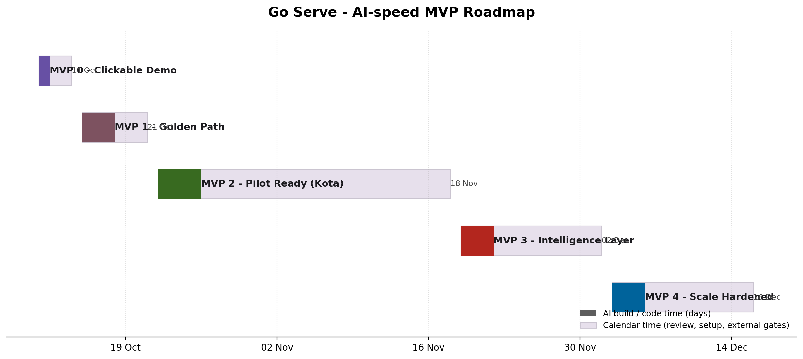

# Go Serve — PRD (First MVP)

**Date:** 11 Oct 2026
**City we start in:** Kota
**Written for:** the founder. Plain English. No jargon.

---

## 1. The simple answer first

**The smallest MVP is one working order.**

We build one Progressive Web App (PWA). It opens in a browser. It looks like a mobile app. A customer taps a few buttons and places one real order. The order travels through the backend. The kitchen sees it. A rider is assigned. The customer sees live status. At the end, the order shows "Delivered".

That is the whole MVP. No payments. No animations. No AI chat. Just one clean, working order path.

Why this is the right first step:
- It proves the hard part: the order flow and the live events.
- One investor can open one link and see a real order happen in 10 minutes.
- We can grow this into the full system later without throwing the code away.

---

## 2. Product goal

Go Serve delivers fresh, cooked food to a customer's door in about 15 minutes.

The software is the "Food OS". It runs everything: the customer app, the kitchen screen, the rider app, and the head office dashboard.

The MVP must prove one thing: **food can move from our kitchen to a customer, with live tracking, with no manual calls.**

---

## 3. Who uses it

| User | What they do | Where they use it |
|---|---|---|
| Customer | Orders food, tracks it | Phone browser (PWA) |
| Kitchen staff | Sees and cooks orders | Kitchen tablet (PWA) |
| Rider | Gets order, delivers it | Phone browser (PWA) |
| Ops / Founder | Watches the whole business | Laptop (PWA) |

Everyone uses the same PWA. Different people see different screens after login.

---

## 4. What the Week-1 MVP does (the demo)

This is the first thing we build. It must be ready in **7 days**.

- The PWA opens from a link. It looks like a mobile app.
- The customer picks a saved address inside our delivery zone.
- The customer sees a short menu. Around 10 to 20 items.
- The customer taps items, sees a cart, and taps "Place Order".
- The backend runs real order functions. The order is saved in a real database.
- The kitchen screen shows the new order with a sound/alert.
- The kitchen staff taps through order states (received, preparing, ready).
- A rider is assigned. For the demo, assignment can be simple (nearest one).
- The customer's screen updates live as the order moves.
- The customer gets a confirmation at the end.

**Not in the demo:** real money, real SMS, fancy animations, deep analytics.

---

## 5. Full MVP feature list (one line each)

### 5.1 Customer app
- Phone login with OTP.
- Add and save a delivery address.
- Check if the address is inside our delivery zone.
- See a menu by category, with price and photo.
- Open an item, read it, pick quantity, add to cart.
- Edit the cart and see the full bill.
- Place the order and see the order number.
- Track the order live (confirmed, preparing, ready, assigned, picked up, arriving, delivered).
- See past orders and tap "reorder".

### 5.2 Kitchen screen
- See every new order as it arrives.
- See each order's items and any special notes.
- Move an order through states: Received, Accepted, Preparing, Packing, Ready, Handed Over.
- See a timer on each order (how old it is).
- Mark an item or the whole kitchen as "out of stock" / "paused".
- See simple numbers: orders waiting, orders per hour, late orders.

### 5.3 Rider app
- Log in and go online or offline.
- Get an order assignment (pickup and drop).
- See pickup address and drop address.
- Confirm pickup at the kitchen.
- Send live location while delivering.
- Confirm delivery with a customer OTP or PIN.
- See how many trips done today.

### 5.4 Dispatch
- Assign a rider to each ready order.
- Decide using simple rules first: who is free, who is closest, who is least busy.
- Allow the ops team to change an assignment by hand if needed.
- Keep the design ready for batching (one rider, many orders) later.

### 5.5 Head office dashboard
- See live numbers: orders, sales, active riders, late orders.
- See each kitchen's load and health.
- Open any single order and see its full timeline.
- Get alerts for late orders, out-of-stock items, and payment issues.

### 5.6 Menu and catalogue
- Add and edit categories, items, prices, and photos.
- Set items available or unavailable per kitchen.

### 5.7 Inventory (light)
- Keep a simple list of ingredients and their stock.
- Link each menu item to its ingredients.
- Reduce stock automatically when an order is placed.
- Alert when stock is low.

### 5.8 Payments
- Take online payments through a gateway.
- Handle success, pending, and failure.
- Refund when an order is cancelled.
- Never double-charge (idempotent, explained in section 10).

### 5.9 Notifications
- Send order updates on app, SMS, and WhatsApp.
- Events: OTP, order confirmed, preparing, rider assigned, arriving, delivered, payment failed.

### 5.10 Accounts and access
- Role-based login: customer, kitchen, rider, ops, admin.
- Each person sees only their own screens and data.

---

## 6. What we will NOT build now (non-goals)

- No native mobile app. PWA only.
- No general AI chatbot for customers.
- No complex ML forecasts at launch.
- No multi-city or multi-brand setup. One kitchen, one zone first.
- No fancy animation or heavy design. Clean and fast only.
- No full ERP. Inventory stays light.

We keep the shape ready for these later. We do not build them now.

---

## 7. Technology we will use (all free tiers)

Rule: use free, open tools. Pay nothing at the start. Do not lock our code to one vendor.

| Layer | Tool | Why | Free tier |
|---|---|---|---|
| App (PWA) | Next.js + TypeScript | One codebase, works on web and phone | Free |
| Design system | Material Design 3 (M3) | Google's open design system. Looks modern and clean | Free |
| Hosting | Cloudflare Pages | Free hosting, fast, works worldwide, allows business use | Free |
| Backend API | Hono (TypeScript) | Small, fast, easy. Runs anywhere | Free |
| Database | Supabase (Postgres) | Real SQL database. Good for orders and money records | Free (500 MB) |
| Login | Supabase Auth | Phone and email login out of the box | Free |
| Live updates | Supabase Realtime | Push live order status to screens | Free |
| Queue and cache | Upstash Redis | Handle events, retries, and rate limits | Free tier |
| Push notes | Firebase Cloud Messaging | Send app notifications to phones | Free |
| Files and photos | Oracle server / Supabase Storage | Store menu photos and backups | Already owned |
| Decision engine | Jev by TypeSafe AI | Fast decisions for dispatch and pricing | Pay-per-use, tiny cost |
| Backup brain | OpenRouter free models | For small tasks like summaries | Free pool |
| Own server | Oracle (4 vCPU, 200 GB) | Run workers, local models, backups | Already owned |

Why this stack:
- Postgres is a standard. We can move it to any cloud later with no code change.
- Hono runs on many clouds. We are not stuck with one host.
- Supabase gives login, database, and live updates in one place. Fast to start.
- Everything here has a working free tier today.

---

## 8. How the system works (in plain words)

Think of the backend like a post office for order events.

1. The customer taps "Place Order". The PWA sends one request to the API.
2. The API saves the order in Postgres. It writes one event: `order.placed`.
3. A background worker picks up the event. It runs the next steps:
   - Tell the kitchen (new order).
   - Ask the decision engine which rider to assign.
   - Send a notification to the customer.
4. Each state change writes a new event: `order.accepted`, `order.ready`, `order.picked_up`, `order.delivered`.
5. Every screen listens to these events. It updates live. Nobody has to refresh.
6. The ops dashboard reads the same events to show live numbers.

This is called an **event-driven** design. It is how large systems (like banks and Amex-style platforms) handle heavy traffic without breaking. One slow part does not stop the rest.

Two small rules we follow from day one:
- **Idempotency:** if a "pay success" message comes twice, we charge once. We use a unique order ID to check.
- **Single source of truth:** Postgres holds the truth. Events flow out of it. We never keep two disagreeing copies.

---

## 9. The decision engine (Jev, in simple words)

Jev is a special AI model made by TypeSafe AI. It does **not** chat. It does **not** write text.

You send it the state of the world (for example: 4 orders waiting, 3 riders free, this rider is 1.2 km away). It sends back a **decision** with a **confidence score**. It answers in about 0.1 seconds. It cannot hallucinate, because it only picks from choices we allow.

Where we use Jev from day one:
- Which rider to assign to which order.
- Which order to cook next.
- What is the real delivery ETA.
- Which orders are at risk of being late.
- Which offer or coupon fits this customer (later).

Why this matters:
- Normal AI chat is too slow and too random for these jobs. Jev is fast and safe.
- It is cheap. Input is about $0.042 per million words. Output is free.
- It gives a confidence number with every answer. If confidence is low, we fall back to simple rules.

Important safety rule: **Jev never sits directly in the payment path.** It only suggests. Normal code decides. If Jev fails, simple rules take over. This also keeps our app a PWA that just calls Jev through our backend.

We keep Jev behind one small interface in our code. Later we can swap in our own tuned model with no change to the app.

---

## 10. Data and events (the order's life)

An order is a story with clear steps. Each step is an event.

```
placed → accepted → preparing → ready → rider_assigned → picked_up → arriving → delivered
```

Every event has:
- A time stamp.
- Who caused it (customer, kitchen, rider, system).
- The order ID.

We store all events. So we can always answer: "Where did the time go?" This matters because 15-minute delivery is a race against the clock.

---

## 11. Scale target

Swish, a 10-minute food startup, ran its first year in one area of Bengaluru. It grew from a few thousand orders a day to about 20,000.

Our target for the first year:
- Start with 1 kitchen in Kota.
- Grow to a few hundred orders a day per kitchen.
- The software must handle **up to 5,000 orders a day per kitchen** without breaking.
- The same code must scale to many kitchens later by adding config, not by rewriting.

We test this with a load test before we call a version "done".

---

## 12. Assumptions and open questions

Assumptions we made:
- First kitchen is in Kota. One delivery zone first.
- Menu starts small: 10 to 20 items.
- Phone OTP may need a small paid SMS tool later. For the demo we use email or a dev code.
- Urdu/English/Hindi labels can be added later; MVP in English.

Open questions for the founder:
- What is the exact first kitchen location in Kota?
- How many orders per day do we expect in month 1?
- Do we need real payments in the week-1 demo, or is a "pay later" button fine?
- Do we want a subscription (daily meal plan) in V1, or only single orders?

---

## 13. Roadmap



**Why these dates are shorter than the first version:** AI writes the code, not a human. So coding is now the small part. The real drivers are human review, setup, and outside approvals (payment KYC, SMS, WhatsApp). The chart shows both: the dark part is AI build time, the light part is the rest of the calendar.

Two things stay slow and cannot be rushed:
- **Outside gates:** payment KYC, SMS sender approval, and WhatsApp Business approval. These take weeks. We start them on day one, in parallel.
- **Your decisions:** kitchen, menu, zone, and pilot rules. The software can be ready before the business is.

See `IDEAS.md` for how we plan to measure AI build time honestly.

Five steps. Each step is a working product you can see and click.

### MVP 0 — Clickable Demo (by 14 Oct 2026)
- One PWA link that looks like a mobile app.
- Here we show: the full click path and one real order.
- Backend really runs: order is saved, kitchen sees it, status updates live.

### MVP 1 — Golden Path (by 21 Oct 2026)
- Here we show: the whole order works end to end, with real login and a real database.
- Customer → Kitchen → Rider → Customer, all connected.
- Rider assignment and live tracking work.
- Jev handles dispatch and ETA.

### MVP 2 — Pilot Ready (by 18 Nov 2026)
- Here we show: a real pilot can run in Kota with real money.
- Online payments, refunds, and notifications (SMS/WhatsApp) work.
- Menu admin, light inventory, and low-stock alerts work.
- Head office dashboard shows live health and alerts.

### MVP 3 — Intelligence Layer (by 2 Dec 2026)
- Here we show: the system helps run the business, not just record it.
- Demand forecast for each time window.
- Kitchen helper: what to cook next, where the queue is stuck.
- Delivery helper: rider use, late-order risk, spare capacity.
- Founder copilot: ask business questions in plain words, get grounded answers.

### MVP 4 — Scale Hardened (by 16 Dec 2026)
- Here we show: the system stays fast under Year-1 load.
- Load test to 5,000 orders per kitchen per day.
- Better monitoring, retries, and clear error alerts.
- Cost check: keep it inside free or cheap tiers.
- Ready for kitchen #2 with config only, no new code.
