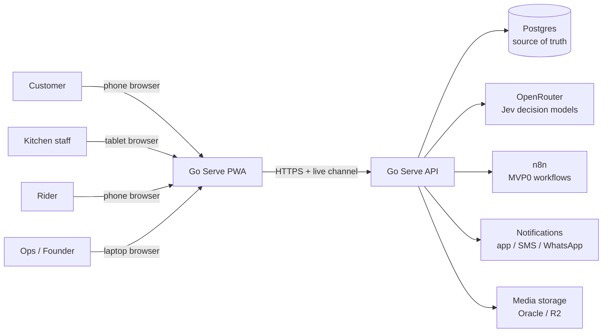
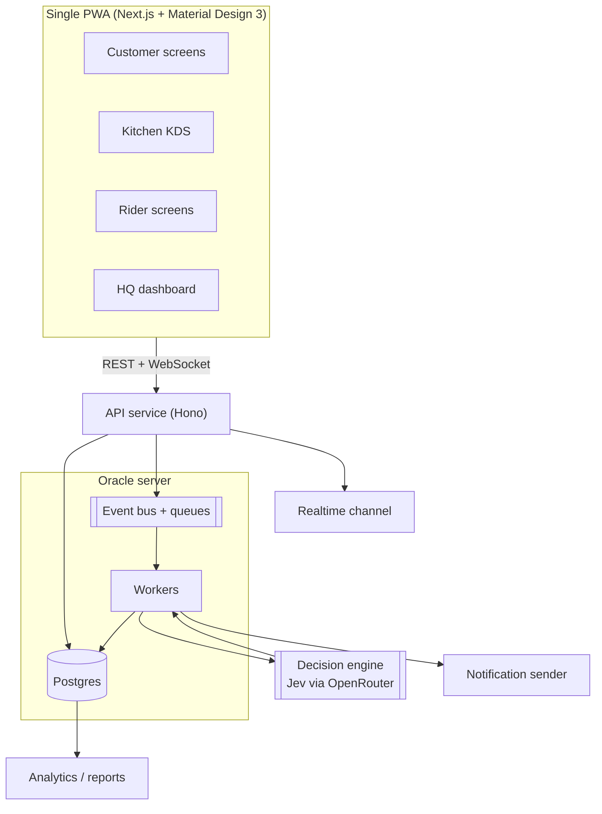
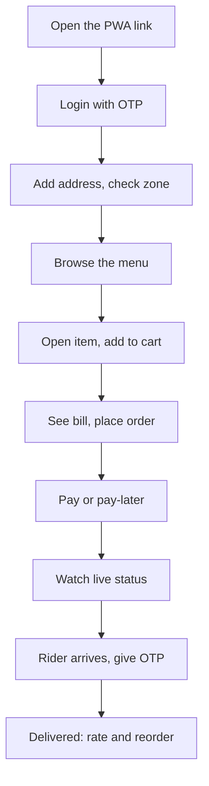
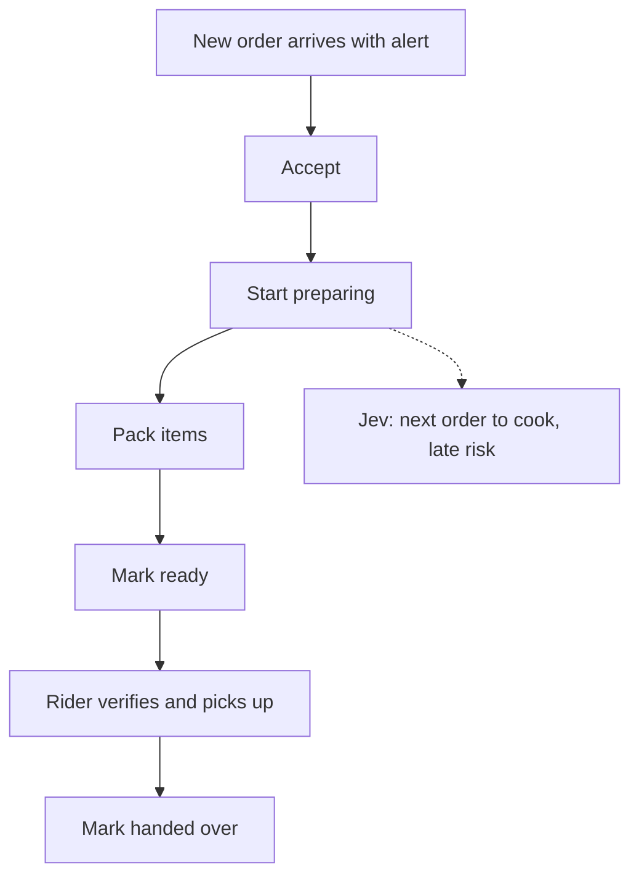
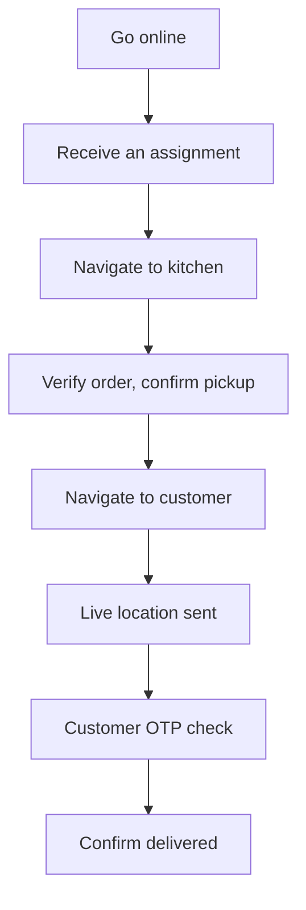
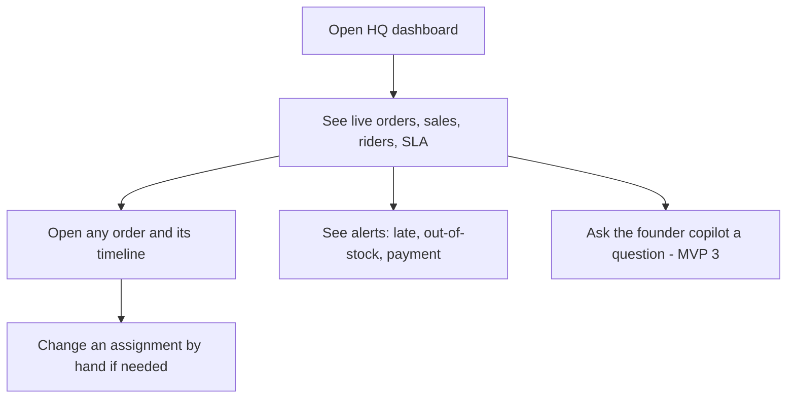
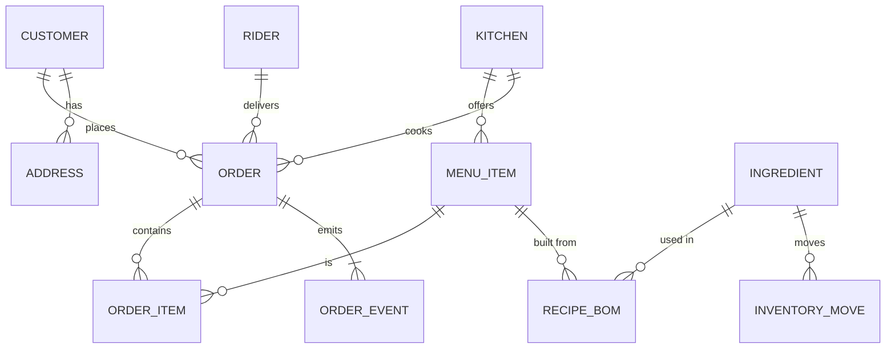

# Go Serve — Solutioning Document

**Date:** 11 Oct 2026
**Plain English.** This is the whole-system plan from start to end. It is a plan, not code.

---

## 1. Why this document exists

We want to build Go Serve once and not rewrite it later. So we first decide the shape of the whole system. Then every MVP is a slice of this same shape, not a throwaway.

Five design rules guide everything:
1. **One PWA.** One link, one codebase. Customer, kitchen, rider, and ops are different screens inside it.
2. **Backend does the work.** The browser only shows screens and calls our API. All logic and all decisions live on the server.
3. **Event-driven.** Every order step is an event. Screens listen and update live. No one refreshes anything.
4. **Postgres is the truth.** One database holds the real state. Everything else is derived.
5. **Free first.** We use our own Oracle server plus free tiers. No paid tool until it earns its place.

## 2. The environment we already have

- **Oracle server** (`linkright-server`): 4 vCPU, 22 GB RAM, 66 GB free disk. Already running Postgres, MongoDB, n8n (pm2), nginx, a Cloudflare tunnel, and local models (Ollama).
- **n8n** at https://n8n.LinkRight.in for fast no-code workflows.
- **OpenRouter** for Jev decisions and small free-model tasks.
- **Free LLM pool** on the laptop for tiny jobs.

We do not need to buy anything for the MVP.

## 3. System context (who talks to what)

## 4. Containers (the main parts inside)

Every arrow is a small, replaceable part. We can move one part to a managed cloud later without touching the others.

## 5. The order's life (event flow)

```mermaid
flowchart LR
  PL[order.placed] --> AC[order.accepted]
  AC --> PR[order.preparing]
  PR --> RDY[order.ready]
  RDY --> AS[order.rider_assigned]
  AS --> PU[order.picked_up]
  PU --> AR[order.arriving]
  AR --> DL[order.delivered]
  DL --> RT[order.rated]
  RDY -.->|Jev D1| AS
  PL -.->|Jev D5 zone / D6 abuse| AC
  AS -.->|Jev D2 ETA| PU
  PR -.->|Jev D3 next cook / D4 late risk| RDY
```

Every event is saved with a time stamp and who caused it. So we can always answer "where did the time go?"

## 6. User journeys

### 6.1 Customer

### 6.2 Kitchen

### 6.3 Rider

### 6.4 Ops / founder

## 7. Data model (main tables)

Key fields (kept short):
- **ORDER:** id, customer, kitchen, address, status, amounts, payment state, timestamps.
- **ORDER_EVENT:** order id, event name, time, actor, payload. Append-only.
- **RIDER / KITCHEN / MENU_ITEM:** simple master tables with a per-kitchen availability flag.

## 8. Non-functional needs

- **Scale:** must stay fast up to 5,000 orders per kitchen per day (about 3.5 orders/minute average, bursts higher).
- **Latency:** screen actions under 1 second. Live status under 2 seconds. Jev decisions under 1 second.
- **Uptime:** the kitchen screen must never go blank. Fallback rules keep orders moving if AI or network fails.
- **Money safety:** payment actions are idempotent. A repeated message never double-charges.
- **Data safety:** nightly backups of Postgres to the Oracle server's backup folder.
- **Roles:** customer, kitchen, rider, ops, admin. Each sees only its own screens and data.

## 9. The no-rewrite rules

If we follow these, a funded version is the same system with more capacity, not a new system.

1. **Portable core.** Domain logic lives in a plain TypeScript service, not in one vendor's function shape.
2. **Standard database.** Postgres only. Any cloud can host it.
3. **Event-driven.** New features subscribe to events. We do not bolt logic onto the order table.
4. **Idempotent.** Every partner message (payment, SMS) can be repeated safely.
5. **Interface boundaries.** Jev, storage, and notifications each sit behind one small module. We can swap the inside.
6. **Single PWA, role-based.** Adding a role is a new screen, not a new app.
7. **Config for growth.** Kitchen #2 is configuration, not new code.

## 10. Free-cost map

| Need | Tool | Cost |
|---|---|---|
| Hosting / tunnel | Oracle + Cloudflare tunnel | Free (owned) |
| Database | Postgres on Oracle | Free |
| API + workers | Hono on Oracle (pm2) | Free |
| Realtime | WebSocket on Oracle | Free |
| Cache / queue | Upstash Redis free tier, or local | Free |
| Push notes | Firebase Cloud Messaging | Free |
| SMS / WhatsApp | MSG91 / WhatsApp Cloud (small paid later) | Near free at pilot size |
| Decisions | Jev via OpenRouter | About $10-20 / month at Year-1 volume |
| Small AI jobs | Free LLM pool / local Ollama | Free |
| Media | Oracle disk (66 GB free) | Free |

## 11. How n8n fits (and how we avoid a rewrite)

Satvik's point: the clickable demo can be built very fast on n8n workflows. We use that, carefully.

- **MVP 0 (demo):** the PWA calls n8n webhooks. n8n holds the temporary order state and sends status back. This proves the click-path and the live updates in days, not weeks.
- **MVP 1 onward (real):** the API service and Postgres become the real backend. The PWA keeps the same UI and the same API paths.
- **Why this is not a rewrite:** the PWA talks to one API surface. In MVP 0 an n8n workflow sits behind that surface. From MVP 1 our own service sits behind the same surface. Only the thin backend behind the surface changes. The screens, routes, and event names stay.

Rule to keep it clean: design the MVP 0 API paths and event names to match the final ones from day one. Then swapping n8n out for the real backend is a backend-only change.

## 12. What comes next (maps to the roadmap)

- **MVP 0:** PWA + n8n webhooks + one working order. See `roadmap.png`.
- **MVP 1:** API service + Postgres + realtime + Jev decisions D1-D5. Golden path end to end.
- **MVP 2:** payments, notifications, menu admin, light inventory, HQ alerts.
- **MVP 3:** demand forecast, kitchen brain, delivery intelligence, founder copilot (D8-D10).
- **MVP 4:** load test to Year-1 scale, monitoring, backups, kitchen #2 by config.

Fuller system diagram (all boxes) is in `diagrams.html`. Open it in any browser.