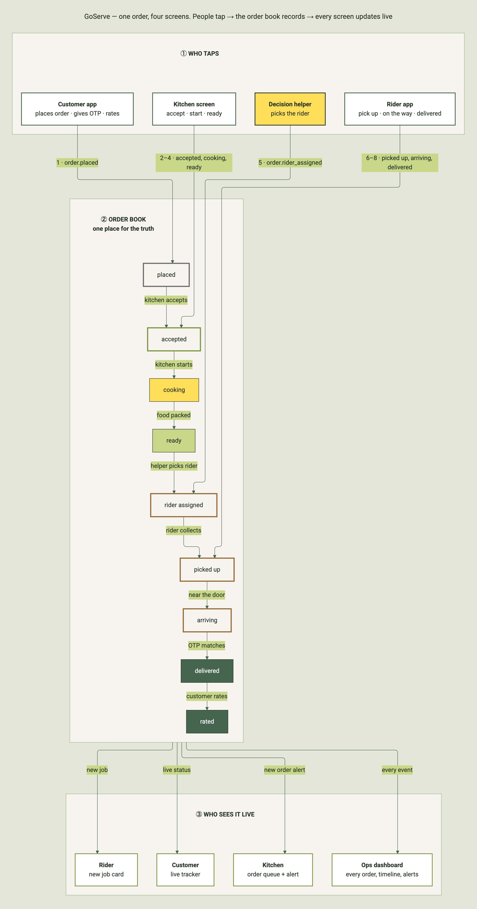
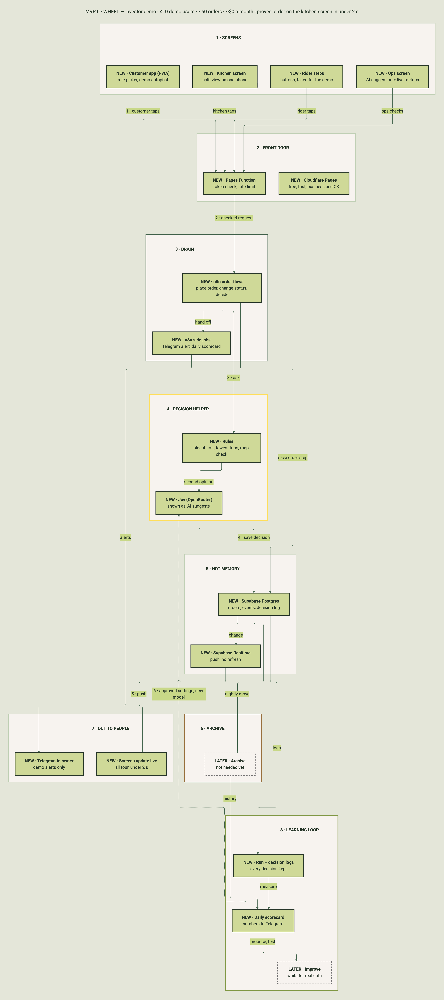
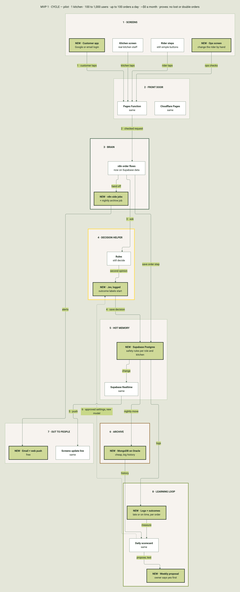
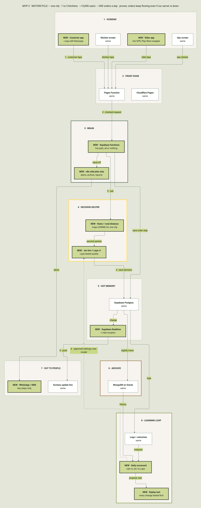
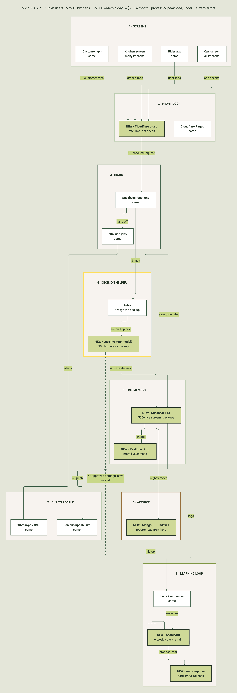
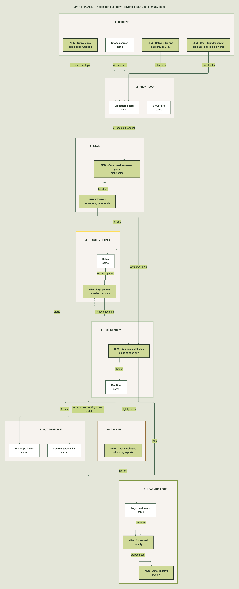
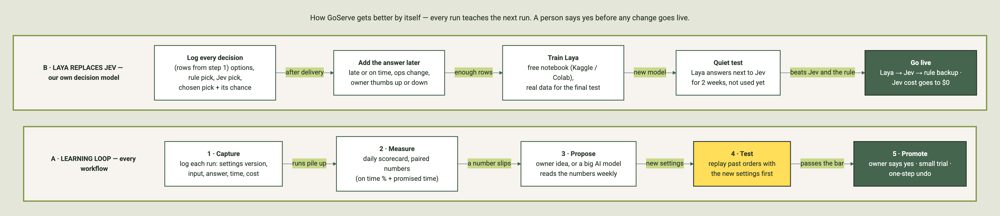

# GoServe — How the system grows

**Date:** 13 Oct 2026
**Written for:** the founder and investors. Plain English.
**Decision record:** `docs/decisions/ADR-004-phased-architecture.md`

---

## The idea in one line

We do not build a plane on day one. We build a wheel, then a cycle, then a motorcycle, then a car. Each step works on its own. Each step keeps the same shape. Only the parts get bigger.

| Phase | Picture | Who uses it | Orders a day | Cost a month | What it proves |
|---|---|---|---|---|---|
| MVP 0 | Wheel | Founder and investors (demo) | ~50 in total | ~$0 | An order reaches the kitchen screen in under 2 seconds |
| MVP 1 | Cycle | 1 kitchen, 100 to 1,000 users | up to 100 | ~$0 | No order is lost or doubled |
| MVP 2 | Motorcycle | 1 to 3 kitchens, ~10,000 users | ~500 | small (messages) | Orders keep flowing even if our own server is down |
| MVP 3 | Car | 5 to 10 kitchens, up to 1 lakh users | ~5,300 | ~$25 and up | Twice the peak load, under 1 second, no errors |
| MVP 4 | Plane | Many cities (vision, not built now) | more | more | — |

Numbers are estimates. See "Load math" below. Each one is tested before we rely on it.

---

## How to read the pictures

- Every phase picture has the same **8 slots**, in the same places. Read from top to bottom.
- **Green-yellow box with "NEW"**: this part is new in this phase.
- **White box**: same as the phase before.
- **Dashed box with "LATER"**: the slot exists, but we do not need it yet.
- **Arrows** are labelled. Numbers on arrows (1, 2, 3...) show the order of events.
- The **dotted arrow** is the learning loop. It sends better settings back to the decision helper.

| Slot | Plain meaning |
|---|---|
| 1 · Screens | What people tap: customer, kitchen, rider, ops |
| 2 · Front door | Where the app lives, and the gate every request passes |
| 3 · Brain | The order logic: place an order, move it to the next step |
| 4 · Decision helper | Picks the rider, the next dish to cook, the delivery time. Rules first, AI second |
| 5 · Hot memory | Live orders, and the push that updates screens |
| 6 · Archive | Old orders and logs. Cheap, big storage |
| 7 · Out to people | Live screens, alerts and messages |
| 8 · Learning loop | Logs, a daily scorecard, and careful improvements |

---

## The order journey (any phase)

People tap. The order book records it. Every screen updates live.



---

## MVP 0 · Wheel — the investor demo



What it is: one app link on the founder's Android phone. An order moves live from customer to kitchen to rider to delivered.

| Slot | What we use | Why |
|---|---|---|
| Screens | One PWA, with a role picker, a split view (customer + kitchen on one phone), and a **demo autopilot** | The founder can demo alone. Autopilot plays the full story on the phone, even with no network |
| Front door | Cloudflare Pages + a small Pages Function | Free. Business use is allowed. The function checks a demo token and limits spam |
| Brain | n8n on our Oracle server | Fastest way to build the logic. We already run it |
| Decision helper | Rules + Jev shown as "AI suggests" | Rules always work. Jev shows the AI part to investors |
| Hot memory | Supabase (database + live updates) | Free. Real database. Pushes changes to screens, no refresh |
| Archive | Later | Not needed for a demo |
| Out to people | Live screens + a Telegram alert to the owner | Enough for a demo |
| Learning loop | Run log, decision log, daily scorecard | We keep every decision from day one. Improving waits for real data |

---

## MVP 1 · Cycle — the pilot



| What changed | Old → new | Why |
|---|---|---|
| Login | Role picker → Google or email login (Supabase) | Free and built in. Phone SMS needs approval and costs money |
| Safety | Open demo → safety rules per role and per kitchen | Each person sees only their own orders |
| Archive | None → MongoDB on our Oracle server, every night | Keeps the free database small |
| Decision helper | Jev for show → Jev logged on real orders, with the real result | This is the training data for our own model later |
| Messages | Telegram to owner → email + web push | Free |
| Learning loop | Scorecard → weekly proposal, owner says yes first | Small, safe improvements |

Move on when: more than ~150 orders a day, or our server going down starts to hurt.

---

## MVP 2 · Motorcycle — one city



| What changed | Old → new | Why |
|---|---|---|
| Brain | n8n → Supabase database functions for the hot path | Placing an order works even if our Oracle server is down. n8n keeps the side jobs |
| Rider | Buttons → real rider app with live GPS (screen on), Play Store wrapper if needed | A browser app cannot track a locked phone |
| Payments | Pay later → Razorpay, with a unique order key | Never charged twice |
| Decision helper | Rules + Jev → rules + road distance + Jev live + **Laya tested quietly** | Our own model learns, but is not used yet |
| Messages | Email → WhatsApp / SMS for key steps | Customers in India expect it |
| Learning loop | Proposal → replay test before every change | No untested change goes live |

Move on when: live screens near 150 at once, or messages near 1.5 million a month.

---

## MVP 3 · Car — 1 lakh users



| What changed | Old → new | Why |
|---|---|---|
| Hot memory | Supabase free → Supabase Pro (~$25 a month) | 500+ live screens, daily backups, never paused. The cheapest step that fits the load |
| Front door | Pages Function → Cloudflare guard (rate limit, bot check) | Protects the system at scale |
| Decision helper | Jev → **Laya live**, Jev only as backup | Our own model. Jev cost goes to $0 |
| Archive | Mongo → Mongo with indexes; reports read from here | The live database stays fast |
| Learning loop | Owner yes for every change → automatic inside hard limits, with a small trial and one-step undo | Safe speed |

Proof: a load test at twice the peak, made by our own order simulator.

---

## MVP 4 · Plane — the vision



Not built now. Native apps from the same code, databases close to each city, a real event queue, Laya trained per city, a data warehouse, and a founder copilot.

---

## How GoServe gets better by itself



- **A. Learning loop.** Every workflow logs what it did. A daily scorecard measures it. Someone proposes a change. We test it on past orders. A person says yes. Then it goes live, with a one-step undo.
- **B. Laya replaces Jev.** We log every decision. We add the real result later (late or on time). We train our own model, Laya. It runs quietly next to Jev. It goes live only where it beats Jev and the rule. Full plan: `docs/ai/LAYA_PLAN.md`.

---

## Where the work happens

| Place | Does | Never does |
|---|---|---|
| The phone (PWA) | Screens, cart total, offline menu, demo autopilot | Anything we must trust: price, decision, payment, final status |
| The front door (Cloudflare) | Checks the token, limits spam, passes the request on | Business logic |
| n8n on our Oracle server | Order logic (MVP 0–1), side jobs, alerts, scorecard | Hold the only copy of an order |
| Supabase | Orders, events, decisions, login, live updates | Keep years of history |
| MongoDB on Oracle | Archive and logs | Live orders |

Rule: the phone makes it feel fast. The server makes it true.

---

## Load math (estimates, to be tested)

- 1 lakh users. About 40% order in a month. About 4 orders each. So about 5,300 orders a day.
- Peak hour is about 15% of the day. So about 13 orders a minute.
- Each order makes about 10 events. About 3 screens watch each order. So about 4.5 million live messages a month. Supabase Free allows 2 million.
- At peak, about 700 screens are open at once. Supabase Free allows 200.
- Each order with its events is about 6.5 KB. 500 MB holds about 2 weeks of orders. So we archive.
- About 4 decisions per order. So about 21,000 decisions a day.
- **Result:** free tiers carry about 1,000 to 2,000 orders a day. 1 lakh users needs Supabase Pro.

Sources and checks: `docs/research/infra-free-tiers-2026-10.md`. Assumptions: `docs/assumptions.md`.

---

## Not decided yet

- The PWA framework (`docs/decisions/ADR-006-pwa-stack.md`, proposed).
- Maps for road distance in MVP 2 (self-hosted or paid, by measurement).
- Whether riders need the Play Store wrapper in MVP 2.

---

## Words used

- **Event:** one step of an order, like "accepted" or "delivered".
- **Order book:** the one place that holds the truth about every order.
- **Decision:** a choice the system makes, like which rider gets the order.
- **Confidence:** how sure the AI is, from 0 to 1.
- **Backup rule:** a simple rule that decides when the AI is unsure or slow.
- **Jev:** a paid decision AI we use through OpenRouter.
- **Laya:** a free, open decision AI we will train on our own data.
- **Log:** a written record of what happened.

---

## How these pictures are made

Each picture has a text source (`diagrams/*.mmd`). The five phase pictures come from one shared skeleton (`diagrams/build_phases.py`), so the boxes stay in the same places. A gate script measures each picture: arrow crossings, arrows through boxes, overlaps, text outside boxes, colours outside our palette. Results: `diagrams/gate-report.json`. Each phase picture has one crossing: the dotted learning-loop arrow crosses the live-push arrow once. This is the only crossing, and the gate allows up to two when they are explained.

```bash
python3 docs/architecture/diagrams/build_phases.py
node ~/.claude/skills/diagram-standards/render.mjs --theme docs/architecture/diagrams/theme.json \
  --out docs/architecture/diagrams/img --seed 3 \
  --compare d1-mvp0,d2-mvp1,d3-mvp2,d4-mvp3,d5-mvp4 docs/architecture/diagrams/d[1-5]-*.mmd
node ~/.claude/skills/diagram-standards/render.mjs --theme docs/architecture/diagrams/theme.json \
  --out docs/architecture/diagrams/img docs/architecture/diagrams/d0-order-journey.mmd docs/architecture/diagrams/d6-learning-loop.mmd
```
